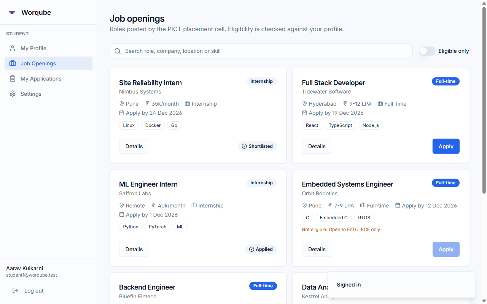
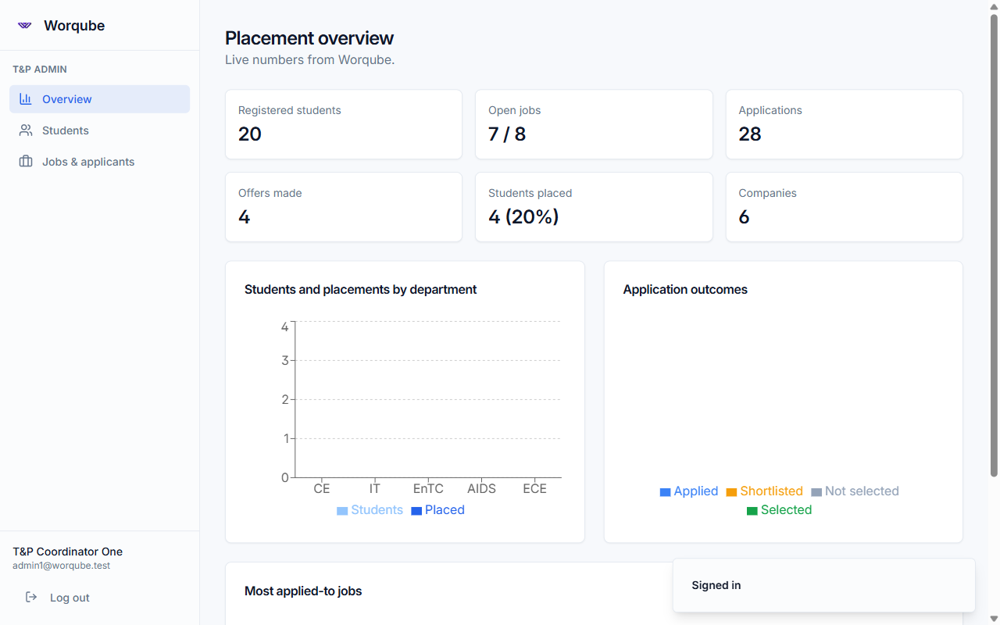
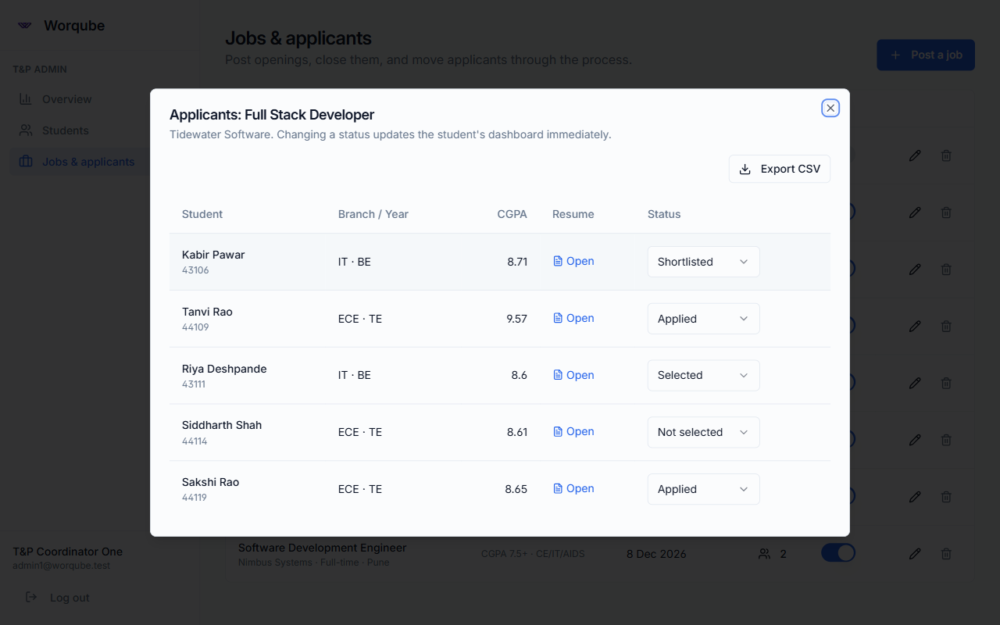

# Worqube

Worqube is a placement portal for the Training & Placement cell at PICT, Pune.



## Quickstart

Try it on your machine with demo data. You need Git and Node.js 22+. No database is needed.

```bash
git clone https://github.com/BhavarthPetare/worqube.git
cd worqube
npm run install:all
npm run build --prefix client
npm run dev:demo
```

You should see `MongoDB` seed output, then `Worqube API on port 5000`. Open http://localhost:5000. The terminal prints the demo logins once. Data is lost when you stop the demo.

**Live demo:** https://worqube-5dwa.onrender.com

It runs on Render's free tier, so the first load after a quiet spell takes about 30 seconds. You can sign up as a student with any email. The T&P cell creates admin accounts. They are not open to sign-up, so the admin screens are shown below.





## What is worqube?

Worqube is a web app where students apply to company drives and the T&P team runs the whole process. Students keep one profile and resume. The T&P team posts drives, reviews applicants and moves them to selection. It replaces the spreadsheets and forms a placement cell would otherwise use.

## What it does

For students: a profile with branch, year, CGPA and backlogs. It also holds skills, projects, experience, certifications and a PDF resume. The job board checks every drive against that profile. If you are not eligible, it tells you why: CGPA too low, branch not listed, too many backlogs, or deadline passed. Applying is one click, and your latest resume goes with it. You can follow each application and withdraw while it is pending.

For the T&P admin: an overview with students, open drives, applications, offers and placement rate. Charts show results by branch and outcome. A student directory can be searched and filtered by branch, year and CGPA. Each drive lists its applicants with resume links, a status dropdown and a CSV export.

## Prerequisites

Install these first. Each line shows the check command.

| Tool | Version | Check |
| --- | --- | --- |
| Node.js | 22 or newer | `node --version` |
| npm | 10 or newer (ships with Node.js) | `npm --version` |
| Git | any recent version | `git --version` |
| MongoDB | 7 or newer, or a free MongoDB Atlas cluster. Only needed outside demo mode. | `mongod --version` |

## Installation

```bash
npm run install:all
```

This installs the client and the server. To check that it worked, run the 20 API tests. They use an in-memory MongoDB, so they need no setup:

```bash
npm test
```

All tests should pass.

## How it's built

React and TypeScript with Vite, Tailwind and shadcn/ui on the front. Express 5, Mongoose and Zod on the back. MongoDB Atlas holds the data. One Node process serves the API and the built app, so the session cookie never crosses sites.

A few decisions:

- The server checks eligibility when you apply, not only in the UI. A direct API call from an ineligible student gets a 422 with the reasons.
- Sign-up always creates a student. Only the seed script sets roles, and every route checks them.
- Resumes are stored in MongoDB GridFS. The server checks the file is a real PDF under 5 MB. It serves it only to its owner and to admins.
- The session is a JWT in an httpOnly, SameSite cookie, so page scripts can't read it.
- Deadlines are plain dates compared in India time. A drive closing on 1 December accepts applications all day on 1 December.

## Configuration

The server reads environment variables. For local work, copy `server/.env.example` to `server/.env`. On Render, `render.yaml` sets them.

| Name | Default | What it changes |
| --- | --- | --- |
| `MONGO_URI` | none (required) | MongoDB connection string. The example file uses `mongodb://127.0.0.1:27017/worqube`. |
| `JWT_SECRET` | none (required) | Secret that signs session cookies. In production it must have 32+ characters and must not contain `change-me`. |
| `PORT` | `5000` | Port the server listens on. |
| `NODE_ENV` | unset | Set to `production` to turn on the strict secret check. |
| `TRUST_PROXY` | off | Set to `1` behind a load balancer such as Render, Railway or Heroku. |
| `NODE_VERSION` | `22` in `render.yaml` | Node.js version Render uses to build and run the app. |

Fixed values in `server/src/config.js`: the session cookie is named `wq_session` and lasts 7 days. In development the Vite client runs on port 8080 and proxies `/api` to port 5000 (`client/vite.config.ts`).

## Examples

Run it against your own MongoDB, with the client in dev mode. Run each of the last two commands in its own terminal:

```bash
cp server/.env.example server/.env
npm run seed
npm run dev:api
npm run dev:web
```

Open http://localhost:8080.

Wipe and reseed the database:

```bash
npm run seed -- --reset
```

Run the tests:

```bash
npm test
```

## Troubleshooting

**`Startup failed: Missing required environment variable: MONGO_URI`**
The server found no database setting. Create `server/.env` from `server/.env.example`, or export `MONGO_URI`. `JWT_SECRET` gives the same error if it is missing.

**`Startup failed: JWT_SECRET is too weak for production (use 32+ random characters)`**
`NODE_ENV` is `production` and the secret is short or still says `change-me`. Make one with `node -e "console.log(require('crypto').randomBytes(48).toString('hex'))"`.

**`Error: listen EADDRINUSE: address already in use :::5000`**
Another program uses port 5000. Stop it, or start Worqube on another port with the `PORT` variable. In dev mode, the Vite proxy expects port 5000.

## Contributing

Fork the repository and create a branch. Make your change, then run `npm test` and `npm run lint --prefix client`. Open a pull request against `main` and describe what changed and why. CI runs the quickstart on every push.

## Roadmap

Planned next: email and in-app notifications, so students hear about status changes without opening the app. Out of scope for now: interview scheduling and company logins. Ideas and bugs go in the [issue tracker](https://github.com/BhavarthPetare/worqube/issues).

## History

The first version was a Lovable prototype on Supabase. The Supabase project was deleted, so nobody could sign in. Anyone could also register as an admin by picking a tab on the sign-up form. I rebuilt the backend on Express and MongoDB and closed that hole. I replaced the mock job board with real data. I removed the screens that did nothing: notifications, messages and theme settings.

## License

[MIT](LICENSE)

## Author

Bhavarth Petare, [@BhavarthPetare](https://github.com/BhavarthPetare)
